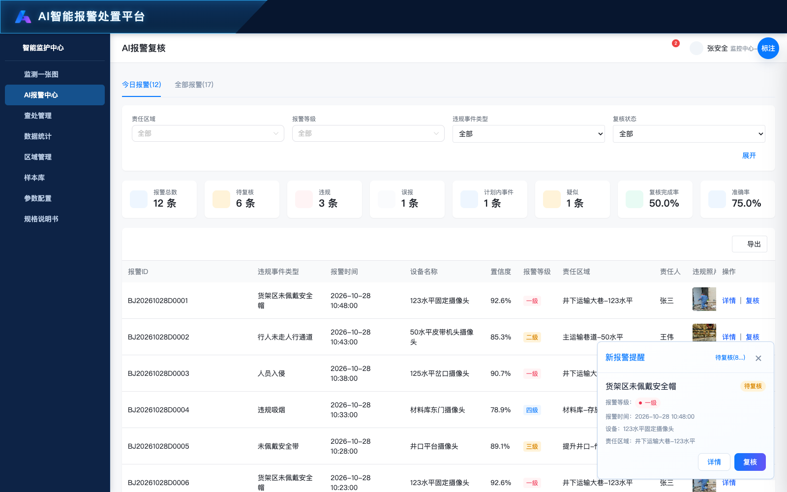

# 深圳平湖中外运项目需求文档

日期：2026年10月28日　用途：研发实现与测试用例设计

保留本地复核和处置，同时通过接口同步华南处理结果。本文沿用现有需求文档的八章结构，以页面截图和【规则名称】逐项说明输入、查询、状态、操作与反馈。接口映射及未决口径集中列于附录，确认后进入开发与验收基线。

规则编号R001起用于研发、测试及缺陷追踪；截图中的演示数量不作为固定验收值。“当前原型”描述现状，“待确认”条款不作为已确定接口方案。

参考需求文档：https://docs.qq.com/doc/DQmpoT05oaFFvWENQ

原型入口：https://hot-gugu.github.io/waiyunpinghu/隐患违章管理-违章查处.html

## 目录

一、全局需规

二、监测一张图

三、ai报警中心

四、查处管理

五、数据统计

六、区域管理

七、样本库

八、参数配置

附录

## 一、全局需规

### （一）业务边界与流程

原型文件：华南平台联动业务流程图.html

**【本轮确认的业务边界】R001** 保留本地复核和处置能力，同时对接华南平台同步结果。2026年10月28日用户确认该口径，替代原需求前言中“我司只做展示与数据回显”及历史标注中“本地入口全部隐藏”的描述。同步字段、状态映射和调用方式按双方接口文档对接。

**【AI业务流程】R002** AI报警进入待复核 → 复核人员查看证据并提交确认违规、误报、计划内事件或疑似 → 只有确认违规进入查处管理 → 处置人员可直接进入处置填写并提交 → 完成处理。接收处置入口保留，但本地处置不以先接收为必要条件；不得沿用“未接收不能处置”的旧规则。

**【来源隔离】R003** 按可信来源字段及设备关联区分AI和消防，不按事件名称猜测。AI烟雾、焰火、消防通道堵塞仍为AI事件。消防不进入AI报警中心、AI复核及样本库，不因旧数据携带等级或复核结果而获得AI操作资格。

**【消防业务流程】R004** 消防报警由消防管家提供状态，本平台展示最新待处置或已处置状态及可用更新时间，不提供本地AI复核、接收及处置表单。符合超期条件时允许值守人员记录线下电话介入；记录电话不改变消防状态。

**【按钮权限】R005** 复核人员可复核；处置人员可处置；值守人员可新增及再次电话介入；其他角色可查看详情和历史。权限还受来源与状态约束。列表按钮、详情底栏、直接链接和提交均校验，不以原型中的演示角色切换替代正式鉴权。

**【身份字段】R006** 责任区域候选人员、复核人、处理人、违规人员分别存储和展示。候选人员匹配不代表已接收；复核人和处理人保留实际操作身份，不能随当前登录人变化；违规人员是行为当事人。

**【原型数据边界】R007** 截图中的数量、人员、时间、设备读数和位置均为演示值。浏览器共享存储支持同源页面演示联动，不等于服务端持久化、跨设备同步、短信服务或华南接口已经上线。

### （二）华南结果同步

原型文件：隐患违章管理-违章查处.html

**【同步触发与定位】R008** 华南每次先期或后续处理提交后，通过接口关联到同一报警记录。按稳定报警业务标识更新对应记录，不以设备名称或页面行号关联，不重复新增同一事件。具体关联键由接口文档确定。

**【最新结果回显】R009** 收到有效回传后比对并更新最新复核结果及处理状态，不锁定第一次结果。示例：首次有效性为正确，对应确认违规；后续改为疑似时，当前复核结果也改为疑似。疑似计入已复核，但不进入准确率样本。

**【保留处理历史】R010** 第一次、第二次等先期处理节点保留，各自包含更新时间、处理人员、处理说明、整改措施及照片；最新回传更新当前状态，不覆盖掉已存在的独立历史节点。

**【接口对接待定】R011** 字段清单、其余有效性映射、时间与时区、重复及乱序回传判断、本地操作与回传冲突优先级、回传鉴权和失败补偿均须接口文档确定。未确定前不把这些方案编写为已确认的开发规则。

**【同步后的联动】R012** 同一报警的列表、详情、处理记录及后续统计读取一致的最新结果；已生成的安全管理报告保持生成时快照。由确认违规改为疑似后，既有处理历史、样本移出及统计重算的最终业务关系，见待确认项Q02。

### （三）全局卡片与平台入口

原型文件：index.html

**【平台入口】R013** index.html作为平台入口，进入AI报警中心，并保留URL查询及锚点参数；后台导航提供监测一张图、AI报警中心、查处管理、数据统计、区域管理、样本库、参数配置及规格说明书。页面标题与导航选中项对应。

**【新报警提醒】R014** 监测一张图采用页内报警栏；其他业务页面共用右下角AI待复核提醒。消防不计入提醒数量。提醒显示事件、待复核状态、等级、报警时间、设备、责任区域及详情或复核入口。

**【提醒显示与关闭】R015** 当前原型先显示一条、5秒后显示第二条，最多同时2条，最新在底部；每条出现10秒后消失，可单条关闭。有提醒时隐藏数量浮标，无提醒时恢复。该时序为演示表现，生产推送机制另行对接。

**【待复核抽屉】R016** 待复核数量入口打开待复核列表；详情及复核必须携带当前alarmId。关闭或Esc返回原页面；非复核人员不应通过提醒获得复核权限。

**【标注功能边界】R017** “标注”按钮及本地文件绑定为原型评审辅助功能，不作为业务系统的后台配置或正式权限入口。

## 二、监测一张图

### （一）园区监测总览

原型文件：方案图册.html

**【独立监测大屏】R018** 独立全屏深蓝监测布局，顶部显示平台、园区、当前日期时间、返回后台与全屏按钮。返回后台进入AI报警中心；全屏按钮申请或退出系统全屏。平台入口与品牌入口均进入本页。

**【园区鸟瞰与楼栋点位】R019** 园区鸟瞰底图仅显示楼栋点位，包含仓库、办公楼、发电间、叉车充电间及配套区域。点位显示楼栋名称和未完成报警数量；点击打开建筑概况，不直接打开设备。支持拖拽、缩放与复位；底图加载失败可重试。点位坐标及楼层布局为演示数据。

**【鸟瞰筛选与范围】R020** 鸟瞰层只保留责任区域（楼栋楼层）树选择、重置和报警栏展开收起。已移除设备类型、违规事件类型、报警等级筛选；加载时清除这些旧选中值，避免隐藏条件继续过滤。选择楼层同步所属楼栋，重置恢复默认范围、今日全部报警与初始地图视图。

**【园区概况与七日趋势】R021** 左侧园区安全概况按全园设备统计总数、在线率、离线数和存在未完成报警的建筑数；消防设备与摄像机分别显示在线／总数、在线率进度和离线数。七日趋势按连续七个自然日统计报警量，展示累计与今日数量；不随局部楼栋筛选变为局部统计。

**【设备在线与报警状态】R022** 消防设备和摄像机分别统计在线数、离线数及总数；在线状态不等于没有报警。消防不展示AI报警等级和置信度，也不参与AI等级优先排序。

**【今日报警栏】R023** 展示当日报警并支持暂停滚动、关键词搜索及展开收起。未完成优先，同类按等级和时间排序。卡片展示事件、时间、设备及当前状态；AI提供与角色和状态匹配的详情、复核或处置入口，消防仅详情。大屏本地处置入口与后台的统一方式见Q01。

**【原型差异】R024** 本次线上仍出现矿区设备名称及消防置信度等演示内容；这些是待整改项，不作为平湖正式设备命名或消防字段要求。

### （二）楼栋与楼层监测

原型文件：方案图册.html

**【楼栋概况与详情联动】R025** 楼栋点位打开建筑概况，显示消防与摄像机在线数、今日总报警、待核警、待处置及今日报警记录；消防记录包含待处置和已处置示例。点击记录打开对应报警详情；查看详情进入该楼栋楼层监测，返回单位鸟瞰回到鸟瞰视图。无法匹配设备的报警提示暂无设备位置。

**【楼层设备与监测值】R026** 楼层监测显示当前楼栋、一层至各楼层及屋顶切换、2.5D演示平面、左侧设备分类与当前楼层报警。分类为独立式电气火灾监控探测器、水压监测装置、水浸监测装置、摄像头，统计在线与离线。分类按钮筛选点位；点击设备显示名称、编号、类型、区域、在线状态和实时监测演示值。摄像机未接入直播时明确提示；支持平面拖拽、缩放和复位。
水浸装置单独分类，展示总数、在线与离线数量，点击筛选当前楼层水浸点位；点位详情显示水浸装置类型、编号、区域及积水监测状态。每个普通演示楼层新增两台水浸设备，设备总数同步增加至12台。

**【楼层报警与详情】R027** 切换楼层后更新设备、报警与未完成数量。点击报警定位对应设备，无匹配位置明确提示。消防待处置与已处置记录均可查看，历史完成记录不计入待办。详情和遮罩不应被楼层容器裁剪，关闭返回原楼层。

**【页内复核】R028** 待复核AI报警由复核人员在大屏弹窗核实；结果与独立复核页使用同一套结果分类、字段校验和共享记录。普通查看者不提供提交入口。

**【视图返回】R029** 范围、楼栋楼层、缩放偏移、侧栏与选中项在返回后恢复；同时读取报警最新状态。旧选中记录已不存在或不属于当前范围时取消选中并提示。

## 三、ai报警中心

### （一）报警列表与筛选

原型文件：AI隐患核查.html

**【今日与全部报警】R030** 今日报警按当日日期过滤；全部报警包含历史记录。Tab显示实际记录数。今日不显示时间筛选，全部显示单个起止时间选择器，默认最近一个月；切回今日不应用全部页的时间限制。

**【筛选与展开】R031** 默认只显示首行条件，其余条件通过展开/收起切换。支持违规事件类型、复核状态、复核结果、复核是否超期及关键词组合筛选。切换与输入后更新列表、统计和空态。

**【列表字段】R032** 报警ID、违规事件类型、报警时间、设备名称、置信度、报警等级、责任区域、责任人、违规照片、复核状态、复核结果、复核人、复核时间、复核超期及操作。仅AI来源，不以消防同名事件混入。

**【等级取高】R033** 最终等级取事件类型配置和摄像头配置中较高等级，一级最高、四级最低。摄像头未配置时使用事件类型等级；不再只读取事件类型等级。

**【统计卡片】R034** 按当前有效查询结果统计总量、待复核、确认违规、误报、计划内事件、疑似、复核完成率及准确率。已复核包含四类结果；准确率＝确认违规÷（确认违规＋误报），复核完成率＝已复核÷AI总量；分母为0显示“—”。

**【复核超期】R035** 默认时限5分钟，可由基础配置修改。待复核从报警时间计算至当前，已复核计算至复核完成时间；超过时限才超期，等于时限不超期。展示实际超期时长并支持按超期筛选。华南回传时间采用接口约定，不用本次页面打开时间替代。

**【分页与导出边界】R036** 线上AI报警中心仍保留演示分页和导出控件，不能据控件存在认定真实功能已实现。正式分页条数、导出格式与全量范围须确认；应与已实现的查处CSV导出区别验收。

**【统计来源返回】R037** 仅从统计下钻进入时在今日／全部Tab行右侧显示返回按钮；返回恢复统计来源查询。直接访问时不显示该按钮。

### （二）报警详情与证据

原型文件：AI隐患核查.html

**【详情信息分区】R038** 标题为AI报警详情，基本信息展示报警、设备、位置、等级、责任人及复核超期；复核结果区单独展示结果、事件判定、类型或误报原因、备注、复核人和复核时间。未填写显示“—”。

**【事件判定】R039** 事件判定与复核结果分别保存。线上独立复核页选项为违规或异常、穿戴不规范、巡检和维保、测试告警、画面异常、算法误报；位于复核结果上方。详情中紧跟复核结果展示，不放入查处详情的报警基本信息；该字段是否必填目前未明确。

**【照片和视频】R040** 照片可放大查看；视频显示当前记录的封面与播放入口。有实际视频源才播放，无源提示暂无可播放的报警视频。演示目标框和播放进度不代表真实算法检测或视频平台已接入。

**【复核入口】R041** 仅待复核AI记录且当前角色为复核人员时可提交；已复核或消防记录不可重复复核。详情查看本身不修改状态。

### （三）人工复核

原型文件：AI识别的违章复核.html

**【进入与返回】R042** 从列表或提醒携带alarmId加载对应报警；普通入口返回AI报警中心，大屏来源返回监测一张图。报警不存在、状态已改变或无复核权限时不允许继续提交。

**【复核结果分支】R043** 结果为确认违规、误报、计划内事件、疑似。切换后只校验当前分支必填字段，不因隐藏分支残留值阻止提交。通用备注随本次结果保存。

**【确认违规】R044** 必须选择有效违规事件类型与报警等级；最终等级按事件类型与摄像头取高。保存为已复核、确认违规；同一报警只形成一份查处记录，重复提交不得重复建任务。短信接入及新流程接收规则见待确认项。

**【误报】R045** 误报类型必选，读取误报类型配置的有效字典。字典没有可用项时不能以空值提交误报；新增、更名和删除后重新读取，失效选中项清空。保存后不生成查处任务。

**【计划内事件与疑似】R046** 不要求事件类型调整或误报原因；保存为已复核。两者都不自动生成查处记录，不进入准确率分母，不进入正负样本库；疑似单独计数。

**【提交反馈】R047** 提交前按分支校验并二次确认；成功保存实际复核人、复核时间、事件判定与结果，列表及统计联动。保存失败保留输入并显示原因；已复核记录拒绝再次提交。服务端权限校验为正式开发要求，当前原型尚未全面实现。

## 四、查处管理

### （一）查询 统计与列表

原型文件：隐患违章管理-违章查处.html

**【页面范围】R048** AI仅确认违规且已复核的报警进入查处；消防独立按来源展示。处理状态统一使用未处理、完成处理、无需处理、先期处理，不混用旧本地待接收／待处置四段流程作为当前处理状态。消防原始状态的页面映射见Q04。

**【筛选条件】R049** 首行包括报警来源、报警时间起止、报警名称、报警等级、处理状态；展开增加处理是否超期、责任区域和关键词。关键词匹配报警ID、设备、区域、处理人、复核人和违规人员。支持组合过滤；重置恢复默认查询且不删除记录。

**【来源切换】R050** 来源可选全部、AI识别、消防设备。切换回到第一页并清除不适用条件；消防模式隐藏AI等级、复核、置信度、违规人员及接收处置相关字段，隐藏的旧条件不得继续过滤消防。

**【统计卡片】R051** 按命中记录计算查处总数、完成处理、无需处理、先期处理、一级报警、未处理、超期未处理和AI处理完成率。原型完成率＝AI完成处理条数÷AI查处条数；分母0显示“—”。无需处理与先期处理不计为完成处理。超期未处理是否纳入先期处理需确认，避免与分析页口径混用。

**【列表字段顺序】R052** 报警来源、处理状态、处理人（责任人）、处理超期、报警ID、报警名称、事件判定、报警时间、设备名称、置信度、报警等级、责任区域、报警照片、复核人、复核时间、违规人员、处理时间、处理周期、操作。查处管理不再显示复核超期及接收时间字段；AI报警中心仍保留复核超期。

**【分页与导出】R053** 每页10／20／50条，显示实际命中总量。导出当前全部命中记录，跨越当前分页，原型格式为带中文字段的CSV；包含来源与当前有效字段，消防不导出旧AI字段。

**【候选处理人】R054** 多名候选人员显示“可处理人有N人”与更多入口；只查看匹配人员，不自动将候选人全部认定为处理人。已有处理人依据本地记录或有效回传展示。

### （二）查处详情与处理记录

原型文件：隐患违章管理-违章查处.html

**【详情入口与分区】R055** 点击详情加载当前alarmId；AI详情含查处详情及处理记录两个Tab。报警基本信息、复核结果、证据分别展示；事件判定位于复核结果区。关闭返回原列表，不因查看改变状态。

**【处理状态含义】R056** 未处理表示尚未完成有效处理；先期处理表示中间进度，仍未完成；完成处理表示已执行并完成；无需处理表示核实后无需处理，当前原型结束跟进。无需处理在统计闭环中的归属按Q03确认。

**【多次先期处理】R057** 时间轴按时间展示报警、人工复核、每一次先期处理及最终完成。每条先期处理有独立更新时间、说明、措施、处理人及可放大照片；不显示最终完成时间与处理周期。

**【最终完成记录】R058** 最终节点展示违规人员、处理经过、整改措施、实际处理人、完成时间、处理周期和照片。周期从首次报警至最终完成，不用某次先期处理时间替代首次报警。详情不再重复增加独立的处理结果区块。

**【处理超期】R059** 保留处理超期，查处管理的复核超期移除。原型仍部分按接收时间计算，但当前已允许不接收直接处置，正式计时起点及无接收时间记录口径必须确定后开发，不直接套旧公式。

**【接口更新】R060** 本地和华南同步结果均回显到同一记录；最新状态更新不丢失多次先期处理历史。具体冲突、重复和乱序规则按接口文档确定。

### （三）本地处置与人员选择

原型文件：隐患违章管理-违章查处.html

**【可处置条件】R061** 本地处置保留，仅处置人员可操作未处理或先期处理的AI记录，无需先接收。接收处置入口可保留，但不能成为阻挡直接处置的条件。消防、完成处理及无需处理记录只读；直接链接与提交同样校验。

**【内部人员】R062** 违规人员必填，默认内部人员。选择弹窗左侧组织树可搜索部门或班组，选组织包含其下级；右侧可按姓名搜索，展示姓名、账号、手机号、部门、班组、岗位，每页10人，单选。确认回填，取消不更改已选值；重新打开带入原选择并重置搜索。

**【外来人员】R063** 切换外来人员后输入姓名和手机号；姓名必填、最多30字符，手机号必填并为1开头第二位3至9的11位号码。外来人员不使用内部组织人员弹窗。切换人员类别不应误提交另一分支的历史值。

**【违规历史】R064** 选定人员后展示历史违规次数、最近记录及事件类型分布，并可查看历史列表；不包含本次未提交事件。内部人员按身份关联，外来人员按已有登记方式匹配，不把处理人历史误当违规人历史。

**【处理文字字段】R065** 处理经过描述及整改措施均必填，各最多500字符。空白或仅空格视为空；验证失败在表单显示具体原因，保留已填写内容。

**【处理照片】R066** 最多3张，每张不超过2MB，仅接收图片。可预览与删除；非图片、超限或读取失败不得加入有效证据。照片是否至少一张目前未规定，不擅自增加必填要求。

**【提交与失败】R067** 点击提交处置先校验，再二次确认；取消确认不保存，成功写入本地完成处理记录及时间并刷新列表。记录已完成或已无需处理时拒绝重复提交；保存失败保留表单。接口同步成功条件、失败重试及回滚策略按接口文档确定。

### （四）电话介入与消防详情

原型文件：隐患违章管理-违章查处.html

**【电话介入权限】R068** 仅值守人员可新增、再次介入及保存，AI未完成且非无需处理时可登记；其余角色可查看历史。消防仅外部待处置且超期后支持，已处置只看历史。当前原型消防按钮条件尚需按该要求整改。

**【电话字段】R069** 联系对象必填、最多30字符；催促或联系内容必填、最多500字符；联系结果必填、最多100字符。记录实际值守人员和登记时间，不自动发起拨号，不修改复核或处理状态。

**【历史与再次介入】R070** 已有电话记录入口打开历史，展示联系对象、内容、结果、人员与时间。再次介入新建独立记录，不覆盖上一条；记录保存失败保留输入。当前原型催接收／催处理阶段由是否接收区分，新流程的阶段命名见Q06。

**【消防详情】R071** 显示外部报警、设备、状态、更新时间及可用处理信息；无数据使用“—”，不编造处理人或完成时间。同步异常保留最近已知状态并说明更新时间，不能冒充实时。消防没有AI等级、置信度或本地AI复核资格。

**【个人信息展示】R072** 消防详情已提供处理人员及联系方式的隐藏／显示入口。展示值与隐藏值应对应同一回传记录；没有人员或号码时不提供无效切换入口。正式可见权限按权限设计确定。

## 五、数据统计

### （一）统计报表

原型文件：统计报表.html

**【查询范围】R073** 默认本月，可选今日、本周、本月、本季度或自定义，按报警发生时间筛选；跨度不超过一年。区域、事件类型和报警等级可清空，重置恢复本月并清空三项。时间无效不能沿用旧结论冒充当前查询。

**【报警报表】R074** 分组明细、合计、排行和导出使用相同查询集，展示总量、确认违规、误报、计划内事件、疑似、待复核、复核超期、准确率及复核率。四类复核结果均须存在，不能漏掉疑似。合计率用汇总分子分母重新计算，不平均各行百分比。

**【查处报表】R075** 查处报表含AI确认违规和消防处理情况；确认违规与待接收仅AI，待处置、闭环、超期和平均时长按已确认混合来源口径。该报表仍有旧状态术语，需与当前四种处理状态统一映射后验收。

**【闭环与平均时长】R076** 原统计基线闭环率＝已闭环÷（AI确认违规＋消防报警）；平均时长仅取起止时间完整的闭环记录。消防超期以外部提供依据为准，不套AI接收时限。无需处理是否计入闭环、当前完成率与闭环率的区别见Q03。

**【下钻与返回】R077** 点击指标、排行或某组明细时携带当前时间、区域、事件类型、等级及目标记录范围，进入AI报警中心或查处管理。返回恢复来源Tab、分组维度及筛选。统计演示记录只读，不写入正式业务台账。

**【导出】R078** 导出当前查询全部分组及合计，数值和口径与页面一致。空样本指标显示“—”；不得把无法计算的比例导出为0或100%。

### （二）数据分析

原型文件：数据分析.html

**【查询与指标】R079** 查询规则与统计报表一致。识别准确率和复核率仅AI；报警趋势总量含AI和消防，确认违规曲线仅AI。疑似计入已复核，不计准确率样本。

**【结果和区域分布】R080** 当前已确认统计标注：结果分布中的确认违规分类合并AI确认违规及消防，其他分类仅AI；确认违规区域分布也按AI确认违规＋消防汇总。分类标题容易与AI核警结果混淆，需在页面tips说明混合口径；图表、占比和下钻保持一致。

**【准确率与闭环趋势】R081** 每日比例按当天有效分母计算，分母0显示“—”。闭环及未完成超期含消防时，以外部有效状态和时间为依据；不能用准确率100%代替处置全部完成，也不能因显示比例四舍五入为100%就认定全部闭环。

**【智能分析优先级】R082** 围绕当前范围的真实记录生成说明：优先提示未完成处理超期，其次超期待复核、普通待复核，再提示其他未完成任务。有多个问题时正文保留剩余待办数量，不只显示一类。尚未复核不能预先当作违规。

**【无数据与全部完成】R083** 无报警时显示暂无记录，不据此声称设备在线或现场无风险；没有待复核不再提示先复核；确认违规全部完成但仍有待复核时，必须同时说明仍需核警。没有可计算样本时准确率或闭环率为“—”。

**【三类建议卡】R084** 任务卡按超期、未接收、待处理、全部闭环等实际情况显示；区域卡按有效区域数量和并列排行显示，缺失区域提示补全，不把未分配当真实重点区域；复核卡优先待复核，再误报核查、计划内说明或复核质量。具体待接收分支需与本轮直接处置规则统一。

**【并列与异常】R085** 并列区域均纳入下钻，不能擅自选唯一第一名。读取失败提供重试，数据矛盾时提示核对，不生成误导建议；点击时目标已无记录则提示刷新，保留当前查询。智能分析是否只看AI与现有含消防实现存在冲突，见Q05。

### （三）安全管理报告

原型文件：安全管理报告.html

**【页面用途与入口】R086** 数据统计下的安全管理报告，用于按周期生成、预览、下载报告并管理自动生成开关。报告为生成时的冻结快照，后续业务数据变化不会改写已有报告。

**【周期自动生成】R087** 日报覆盖前一自然日，周报覆盖前一完整自然周（周一至周日），月报覆盖前一完整自然月。三个开关独立控制。文案统一为“开启后，页面在线时于每日 09:00 后自动生成。”并单独显示“当前状态：已开启／未开启”。

**【自动执行与保存边界】R088** 仅页面打开时在09:00后检查，打开页面或开启开关后检查，并每分钟再次检查；同一类型、周期和数据来源只自动生成一次。页面关闭后暂停，并非后台定时服务，不保证09:00准点执行。设置及报告保存在当前浏览器。

**【报告记录与示例】R089** 报告列表展示名称、类型、统计周期、生成方式、生成时间和操作；支持名称搜索、类型筛选及分页。初始演示报告用于展示列表，不表示当前开关已经开启或真实后台曾执行。

**【生成报告】R090** 页面右上角生成报告打开弹窗，可选日报、周报、月报或自定义；预设类型自动填充相应完整周期。自定义周期须开始不晚于结束、不超过366天，结束不能晚于当前时间。生成成功保存快照并打开预览，失败保留输入并提示。

**【预览与下载】R091** 生成成功保存独立快照并打开预览；列表可预览或下载既有报告。总体与事件类型明细包含确认违规、误报、计划内事件及疑似；旧快照缺少疑似时显示“—”，不伪装成0。新业务数据或配置不追溯改写旧报告，重新生成才获取最新统计。

**【自动生成验收边界】R092** 日报取前一自然日，周报取前一完整周一至周日，月报取前一完整自然月。对页面关闭、09:00之前、09:00之后重开、开关关闭和同周期重复检查分别验证；浏览器页面执行机制不能作为正式后台定时任务已实现的证据。

## 六、区域管理

### （一）责任区域管理

原型文件：责任区域管理.html

**【组织选择与部门范围】R093** 左侧可搜索组织或部门。选中部门显示自身范围；业务单位显示下属部门范围去重汇总，编辑部门范围按钮禁用。部门表格字段为楼栋/场所、楼层、管辖区域、关联视频、操作；视频按钮打开对应楼层已关联视频。

**【人员列表】R094** 选中组织及其下属部门的人员可按姓名、岗位、部门、手机号搜索。展示人员姓名与手机号、部门与岗位、已关联范围、操作。人员模式为跟随部门或独立配置；提供查看范围、编辑管辖范围。分页支持5、10、20人，切换组织、关键词或每页条数回到第一页。

**【编辑部门与人员范围】R095** 部门编辑直接配置范围；人员编辑可按部门继承或按个人独立配置。按部门显示只读继承范围；按个人显示楼栋/楼层/区域勾选树与关联视频，树支持级联、搜索、清空。部门或独立配置保存要求至少关联一个楼栋、楼层或区域；继承模式可保存空部门范围。保存前草稿不改变已生效数据。

**【关联视频与查看】R096** 编辑中关联视频打开独立选择层，支持搜索、区域过滤、分页和当前页选择。区域内隐式关联视频不可重复手动勾选，计数去重。确认后仅更新编辑草稿，最终保存范围才生效。人员查看范围与查看视频为只读弹层，关闭返回来源界面。

**【关闭与保存】R097** 编辑抽屉关闭时检测修改；有修改先提示确认放弃。保存成功写入浏览器，关闭抽屉并提示；失败保留输入和错误。个人按部门模式随部门配置变化，独立配置保持个人范围。当前未与移动端报警派单建立真实权限联动。

**【部门与人员导入】R098** 支持导入部门管辖、人员管辖，默认合并策略；上传后解析并预览，可仅看错误并下载错误明细。部门名称须匹配已有部门；人员需匹配所属部门与姓名，重名需手机号；人员方式为跟随部门或独立配置。跟随部门时楼栋/楼层/区域应留空；独立配置按有效场所层级解析。单次最多2000行。全部错误修正后才能确认导入，失败不更新已保存范围。切换导入类型或关闭清空本次预览。

**【人员匹配与短信】R099** 设备位置与有效管辖范围用于解析候选安管人员；跟随部门和独立个人范围分别计算，区域包含及显式关联视频取并集，同人多范围匹配按稳定人员ID去重。现有标注要求确认违规后逐人短信通知全部匹配人员；短信服务、签名与链接按接口对接，旧“首位接收锁定唯一处理人”不直接沿用至已允许直接处置的新流程。

**【短信内容】R100** 现有模板包含经核警确认的事件类型、最终报警等级、完整区域、摄像头、首次报警时间及小程序链接。消防不发AI处置短信。通知接收人与最终处理人分别管理，链接身份校验及接收锁定是否保留见Q06。

### （二）区域配置

原型文件：区域配置.html

**【页面结构】R101** 当前线上展示三级作业区域树表：一级区域、二级分区、三级作业区域。列为序号、作业区域名称、层级、关联摄像头及操作。二级提供新增作业区域，三级提供编辑、删除及关联摄像头查看。

**【新增及编辑】R102** 点击新增或编辑打开右侧抽屉，字段为区域名称与区域划分，两项必填。名称去首尾空格后不能为空；区域划分未选时阻止保存并提示“请选择区域划分”。取消关闭不提交本次表单。名称长度及同级重名规则目前未定义，见Q07。

**【区域划分】R103** 点击区域划分打开地图选择层，按楼栋、楼层查看房间或片区，确认选择后回填抽屉。仅完成地图层选择不等于已保存作业区域，需再点击抽屉保存。真实GIS边界及坐标对接尚未明确。

**【关联摄像头】R104** 表格显示关联台数，点击查看该区域已关联设备。自动关联设备按页面现有模拟数据更新摄像头并提示成功；真实区域与摄像头关联算法、空间关系及接口需另行明确，不以模拟台数作为生产验收。

**【删除】R105** 三级记录删除前显示名称及确认框；取消保留记录，确认删除目标记录。父子级联删除、已关联报警或责任范围时的限制、撤销及服务端持久化目前未明确。

**【示例数据整改】R106** 当前线上仍显示东鞍采区、主运输巷等矿区示例名称及静态分页。平湖正式楼栋、楼层、区域与摄像头应统一以真实设备和区域数据源为准，不能把这些示例直接做成生产字典。

## 七、样本库

### （一）样本查询与图片导出

原型文件：样本库.html

**【样本来源与分类】R107** 样本库只收录AI来源、已复核、结果为确认违规或误报且复核时间有效的报警。确认违规为正样本，误报为负样本；消防、待复核、计划内事件排除。消防即使带有旧确认违规字段也不得收录。

**【查询与分页】R108** Tab分为全部样本、正样本、负样本。筛选事件类型、复核完成时间起止和关键词，关键词匹配识别设备、责任区域、事件编号。点击查询或关键词回车后生效，重置清空条件；Tab或查询变化回到第1页，每页12条，按复核时间倒序。

**【样本卡片】R109** 每张卡片展示报警照片、正负样本标签、事件类型、识别设备、责任区域、复核完成时间与事件编号；负样本补充误报类型，缺失显示未填写。无命中显示空态，调整筛选后可重查。

**【图片预览弹窗】R110** 来源为样本卡片照片，点击打开当前设备与样本类型标题的图片预览；照片保持比例，关闭返回原列表和查询条件，不修改样本。

**【一键导出所有图片】R111** 导出当前Tab和已应用筛选命中的全部图片，跨越当前分页，打包为ZIP。文件名由设备、事件类型、样本类别组成，非法字符清理、重名追加序号。无记录时禁用，导出中显示加载并防重复点击；成功提示图片数，读取失败显示原因及网页服务打开建议。file协议可能无法读取图片，不宣称导出成功。

**【疑似与同步更新】R112** 疑似不作为正负样本。华南回传改变既有复核结果后，是否立即移出当前样本及已导出样本的追溯方式须接口与业务确认；不能将旧确认违规结果永久视为正样本。

## 八、参数配置

### （一）基础配置

原型文件：基础配置.html

**【配置范围】R113** 仅配置复核时限和处置时限；等级映射在独立报警等级配置页。复核默认5分钟，处置默认30分钟，单位支持分钟和秒。

**【数值校验】R114** 数值必填且为正整数，换算后不得超过365天；0、负数、小数、非数字及超上限不能保存。达到上限但不超过时允许，超过时限才判超期，等于时限不超期。

**【计时起点】R115** 复核从首次报警起算；旧处置默认从接收起算。本轮已允许直接处置，不能再把“有接收时间”作为所有AI记录的超期必要前提；正式处置起点见Q03。消防使用外部规则。

**【保存与联动】R116** 点击保存统一校验，成功提示并更新配置；失败保留输入与错误。列表、详情和统计读取同一套已生效参数。当前保存在浏览器，不代表正式服务器全局配置已接入。

### （二）报警等级配置

原型文件：报警等级配置.html

**【事件与摄像头等级】R117** 支持按22种违规事件类型配置等级；也可通过添加摄像头弹窗批量选择摄像头加入配置列表，再逐台指定等级。摄像头初始不配置等级，不要求覆盖全部摄像头；同一摄像头不可重复添加，支持修改和确认删除。

**【摄像头筛选与批量添加】R118** 按摄像头配置内容区右上角为添加摄像头按钮。主列表支持摄像头名称、所属区域级联下拉（楼栋→楼层→区域，可仅选楼栋或楼层）与报警等级组合筛选；等级仅一级至四级，无未配置等级选项。列表含序号、报警摄像头、所属区域完整路径、报警等级、删除操作。添加弹窗保持楼栋、楼层、区域分项筛选，支持只筛楼栋或楼层，并可按名称及编号搜索；列表多选、全选当前结果，跨筛选保留勾选，已添加摄像头禁止重复勾选。确认加入主列表后逐台选择等级，未选等级不能保存；取消不添加。

**【保存与等级取高】R119** 保存配置统一保存事件类型及摄像头等级，添加、修改和删除在保存后生效，刷新保留。一级最高、四级最低；报警事件等级与上报等级均取事件类型等级和摄像头等级中较高者，未配置摄像头则使用事件类型等级。例如摄像头A一级、事件类型二级，最终报警和上报均为一级。当前为静态原型，未连接真实上报接口。

**【验收示例】R120** 事件二级、摄像头一级，最终报警及上报为一级；事件一级、摄像头三级仍为一级；摄像头未配置则用事件等级。过滤后添加、跨筛选勾选、已添加不可重选、缺等级阻止保存及取消不新增均需覆盖。

### （三）误报类型配置

原型文件：误报类型配置.html

**【默认字典】R121** 首次使用提供14项误报原因，每项含稳定ID、名称和说明。配置未保存时读取默认字典；显式删除全部类型后保留空列表，不自动恢复默认值。

**【查询与列表】R122** 关键词匹配类型名称和说明，实时过滤并显示命中数量。列表展示序号、误报类型、说明和编辑/删除操作；无记录时显示空态。

**【新增与编辑弹窗】R123** 新增按钮打开新增弹窗，编辑操作打开当前记录。名称必填、去除首尾空格后不可为空、最多40字符、不可与其他记录重名；说明选填、最多200字符。保存成功后关闭弹窗并刷新列表；失败保留输入并提示。取消或Esc关闭，不保存。

**【删除确认弹窗】R124** 点击删除打开确认框，显示类型名称和删除后的下拉影响。取消保留记录；确认删除后保存并刷新列表；存储失败在弹窗显示错误。删除后复核下拉不再提供该项，不代表已实现历史复核记录迁移。

**【与复核下拉联动】R125** 配置页与复核页使用同一浏览器本地字典。新增、修改、删除后，复核页在重新打开、切回窗口或收到存储变化时重新读取选项。选中项使用稳定ID，更名保留对应ID；已删除的选中项清空。

**【持久化边界】R126** 配置保存在本机浏览器本地存储，未接入后端或跨设备共享；浏览器策略、不同来源或清除存储可能影响恢复。读取与写入失败均有错误提示。

## 附录

### 其他文件与历史入口

原型文件：规格说明书.html

**【规格说明书入口】R127** 提供需求规格说明书与华南平台联动业务流程图入口；展示文档和流程图用于需求查阅，不是新的业务流程办理页面。历史说明书存在旧接收和移动端规则，以本轮确认及本文待确认项为准。

**【旧移动端文件】R128** 报警处置移动端.html源文件保留但当前导航已移除，截图用于追溯，不自动视为本轮移动端交付范围。若需要恢复移动端，应另行确认入口、身份、直接处置及与华南同步方式。

**【报警图标预览】R129** 报警图标扩散效果预览.html为视觉效果演示，展示消防或摄像机报警扩散等效果，不单独产生报警、处置任务或正式统计数据。

**【完整遍历范围】R130** 本次按线上导航与链接、并结合本地同套原型文件清单核对19个HTML页面；业务脚本、字典和样式作为规则核对依据，不逐个当作业务页面截图。附件清单列出每个HTML的访问结果及截图。

### 待确认项

【Q01 大屏操作范围】本轮已确认保留本地复核与处置。后台入口明确保留；大屏是否也统一提供处置、独立复核页与大屏页内弹窗是否两者都保留，需明确；原型大屏按钮与标注存在冲突。

【Q02 本地与华南结果冲突】本地提交与华南回传冲突时的优先级、重复和乱序回传、确认违规转疑似后的查处记录保留或退出、样本移出和历史审计，均按接口文档与业务确认。

【Q03 计时及闭环口径】允许直接处置后，AI处置计时从报警、复核还是接收起算；无接收时间如何判断超期；无需处理是否计入闭环；先期处理是否纳入超期未处理卡片；现有报表旧状态映射需统一。

【Q04 消防状态与时限】外部待处置／已处置在查处管理未处理／完成处理中的映射、更新及完成时间、超期时限和起点、同步失败提示、实际消防字段按消防管家接口确认。

【Q05 智能分析的来源范围】部分标注要求智能分析只看AI，当前页面文案和计算又纳入消防；需确认综合研判与三张建议卡的统一范围，同时明确“确认违规”混合消防分类的对外名称。

【Q06 短信 接收和通知职责】新流程保留本地处置并接口同步后，确认违规短信是否仍由本系统发送，是否沿用小程序直达、首位接收锁定及催接收／催处理阶段；正式权限矩阵与操作人身份来源同步确定。

【Q07 区域配置的正式规则】名称长度、同级重名、删除关联限制、真实平湖区域层级、GIS选择与自动关联设备规则、持久化和真实分页需补充。当前原型明确的名称及区域划分必填可先实现。

【Q08 其他接口及正式能力】真实视频源、照片存储、短信服务、统计来源、AI中心导出分页、报告后台任务、区域人员导入格式和配置权限，由相应接口及范围评审确认。浏览器演示不代表这些能力已上线。

### 页面遍历与截图清单

下列19个HTML文件均完成线上访问及页面截图。业务页截图在对应章节，其他文件截图在附录；清单中的200为本轮读取结果，不代表业务接口已联通。

|序号|文件|状态|
|---|---|---|
|1|AI智能报警处置平台需求规格说明书_V1.0_评审稿.html|200 已截图 · 说明材料|
|2|AI识别的违章复核.html|200 已截图 · 业务／入口|
|3|AI隐患核查.html|200 已截图 · 业务／入口|
|4|index.html|200 已截图 · 业务／入口|
|5|区域配置.html|200 已截图 · 业务／入口|
|6|华南平台联动业务流程图.html|200 已截图 · 说明材料|
|7|基础配置.html|200 已截图 · 业务／入口|
|8|安全管理报告.html|200 已截图 · 业务／入口|
|9|报警图标扩散效果预览.html|200 已截图 · 视觉预览|
|10|报警处置移动端.html|200 已截图 · 历史保留|
|11|报警等级配置.html|200 已截图 · 业务／入口|
|12|数据分析.html|200 已截图 · 业务／入口|
|13|方案图册.html|200 已截图 · 业务／入口|
|14|样本库.html|200 已截图 · 业务／入口|
|15|统计报表.html|200 已截图 · 业务／入口|
|16|规格说明书.html|200 已截图 · 说明材料|
|17|误报类型配置.html|200 已截图 · 业务／入口|
|18|责任区域管理.html|200 已截图 · 业务／入口|
|19|隐患违章管理-违章查处.html|200 已截图 · 业务／入口|
### 测试设计索引

T01 关联R003：同名烟雾AI与消防分别查询，消防不得进入AI复核及样本库。

T02 关联R001：未接收AI记录可由处置人员直接处理；华南结果通过接口同步到同一记录。

T03 关联R005：四类角色分别验证列表、详情、直接链接及提交权限；隐藏按钮不代替提交拦截。

T04 关联R034：四类复核结果、待复核及0分母分别校验；疑似计已复核、不计准确率。

T05 关联R035：默认5分钟下验证299秒、300秒、301秒及已复核停止计时。

T06 关联R045：无误报原因阻止提交；删除已选字典项后清空无效选择。

T07 关联R044：多次点击或重试不得重复生成查处记录。

T08 关联R057：两次先期处理后完成，保留三次更新；先期节点不显示最终完成时间及周期。

T09 关联R063：空姓名、31字符、错误手机号不能提交；合法值回显正确。

T10 关联R065：空白、500及501字符边界，验证失败保留其他字段。

T11 关联R066：3张与第4张、2MB与超2MB、非图片及读取失败分别验证。

T12 关联R069：30／500／100字符及空白边界，记录电话不改变报警状态。

T13 关联R053：筛选后跨多页导出与命中总量一致；消防不输出AI旧字段。

T14 关联R123：误报名称40字符、41字符、空白、去空格重名；说明200与201字符。

T15 关联R114：0、负数、小数、空值、365天换算边界与超限禁止保存。

T16 关联R118：跨筛选保留勾选、已添加不可重选、缺等级不能保存。

T17 关联R098：2000与2001行、重名缺手机号、错误行及修正后确认，失败不更新有效范围。

T18 关联R102：区域划分未选择不能保存；地图确认后仍须保存区域表单。

T19 关联R091：报告生成后改业务数据，旧快照不变；旧报告缺疑似显示“—”。

T20 关联R009：首次正确后回传疑似，当前结果及统计按最新值更新，处理历史保留。

本次覆盖：19个HTML文件，22个功能小节，130条需求规则，47张截图，8项待确认，20项测试设计检查。
